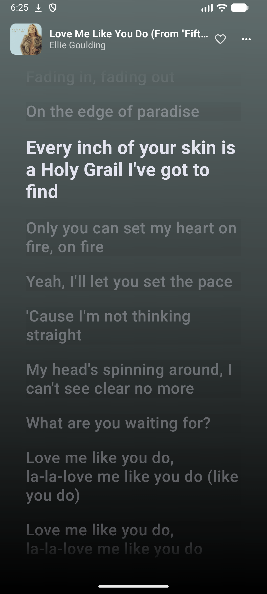
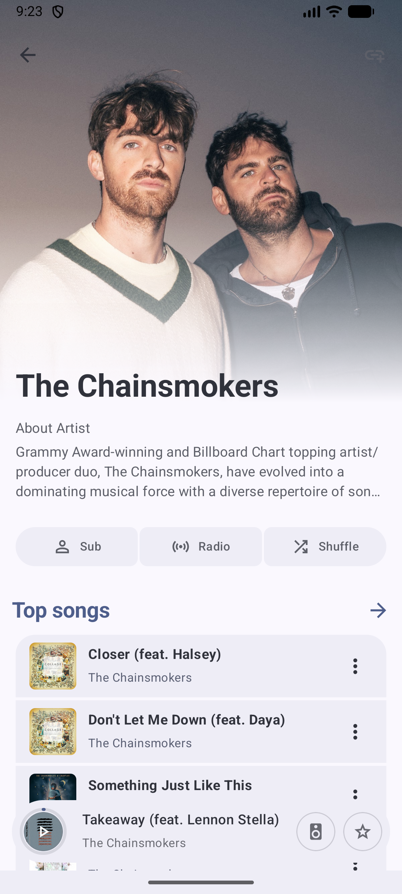
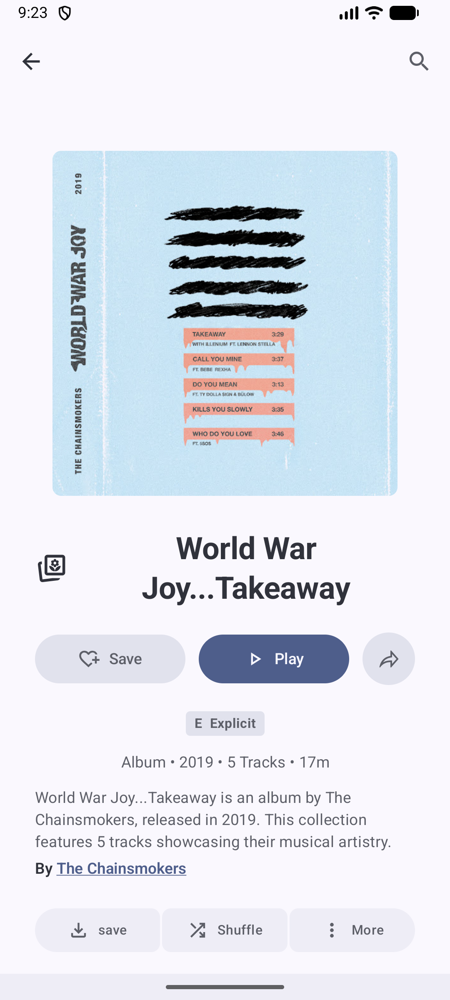
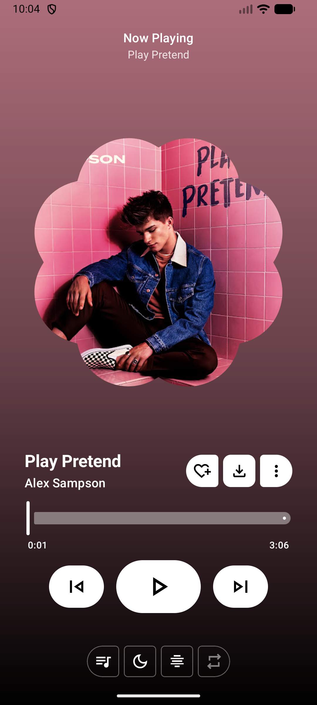

TUNEIFY
Music without boundaries.
One library. Every mood. Your own sound.

A modern Android music experience bringing streaming, local playback, lyrics, playlists, and advanced audio controls together in one beautifully crafted application.

&nbsp;

YOUR MUSIC. YOUR SPACE.
Less searching. More listening.

Tuneify brings your listening experience into one place. Discover music through supported sources, play the tracks stored on your device, build your collection, follow synchronized lyrics, and shape the sound to match your taste.

Designed around a distinctive Premium Burgundy Rose identity, Tuneify pairs a deep, atmospheric interface with powerful music features.
THE EXPERIENCE

YOUR LIBRARY	THE PLAYER
	
Everything in its place.	Every track gets its moment.

LYRICS IN MOTION	SOUND, YOUR WAY
	
Stay close to every word.	Make every detail yours.

Verify the numbered screenshots and adjust the captions if they show different screens.

MORE THAN A MUSIC PLAYER
<table>
<tr>
<td width="50%" valign="top">DISCOVER & LISTEN
Find music through supported online providers and enjoy audio stored on your device.
- Online music discovery and playback
- Local audio library
- Background playback
- Queue and playback controls
- Offline downloads for supported content
</td>
<td width="50%" valign="top">YOUR SOUND, REFINED
Make your listening experience feel personal with a dedicated audio customization environment.
- 10-band and parametric equalizer capabilities
- Headphone correction profiles
- Bass Boost and Reverb
- Spatial audio controls
- ReplayGain loudness normalization
</td>
</tr>
<tr>
<td width="50%" valign="top">LYRICS THAT FOLLOW
A synchronized lyrics experience designed to keep you connected to the music.
- Time-synchronized lyrics
- Word-by-word highlighting where supported
- Multiple lyric presentation styles
- Multiple lyrics providers
- Custom lyric snapshot exports
</td>
<td width="50%" valign="top">YOUR COLLECTION, CONNECTED
Bring supported music libraries and listening services closer together.
- Playlist and library management
- Favorites and listening history
- Supported YouTube Music synchronization
- Supported playlist imports
- CSV library workflows
</td>
</tr>
</table>MADE TO FIT YOUR LISTENING LIFE
Connected listening

Tuneify includes integrations and platform features designed to extend the experience beyond the app:
- Discord Rich Presence
- Last.fm and Libre.fm scrobbling
- Android Auto support
- Google Cast support
- Shazam recognition integration
- Home screen widgets and media controls
Availability depends on provider support, account permissions, device capabilities, and application configuration.
A SIGNATURE LOOK

PREMIUM BURGUNDY ROSE
Dark by nature. Distinct by design.

A visual language built around rich dark surfaces, carefully placed rose accents, clear typography, and a consistent interface.
BUILT FOR ANDROID
Tuneify is developed with a modern Android technology stack.
AREA	TECHNOLOGY
Language	Kotlin
UI	Jetpack Compose, Material 3
Media	AndroidX Media3 / ExoPlayer
Dependency injection	Hilt / Dagger
Persistence	Room, SQLCipher, DataStore
Images	Coil 3
Networking	Ktor Client, OkHttp
Serialization	Kotlinx Serialization
Visual effects	AGSL shaders

GET TUNEIFY

READY WHEN YOU ARE.
Download the latest published build from GitHub Releases.

Minimum Android version: Android 7.0 (API 24)

BUILD FROM SOURCE
Requirements
- Android Studio Ladybug / Meerkat or newer
- Android SDK 36
- JDK 17 or JDK 21
Clone
git clone https://github.com/Abhayp56/Tuneify.git
cd Tuneify
Build a debug APK
Windows PowerShell
.\gradlew.bat :app:assembleUniversalFossDebug
Linux / macOS
./gradlew :app:assembleUniversalFossDebug
Build a release variant
./gradlew :app:assembleUniversalFossRelease
Build outputs are generated under:
app/build/outputs/apk/
Release distribution may require signing configuration.
OPEN SOURCE. BUILT WITH RESPECT.
Tuneify is distributed under the GNU General Public License v3.0.

This project builds upon existing open-source work and third-party libraries. Please review the repository's LICENSE and applicable third-party notices before modifying or redistributing the application.

Contributions, bug reports, and suggestions are welcome.
- View source code
- Report a bug
- Browse releases

TUNEIFY
Feel every note.
Made for the music. Built for the listener.

<a href="https://github.com/Abhayp56/Tuneify">GitHub</a>
 · 
<a href="https://github.com/Abhayp56/Tuneify/releases">Downloads</a>
 · 
<a href="https://github.com/Abhayp56/Tuneify/issues">Support</a>

